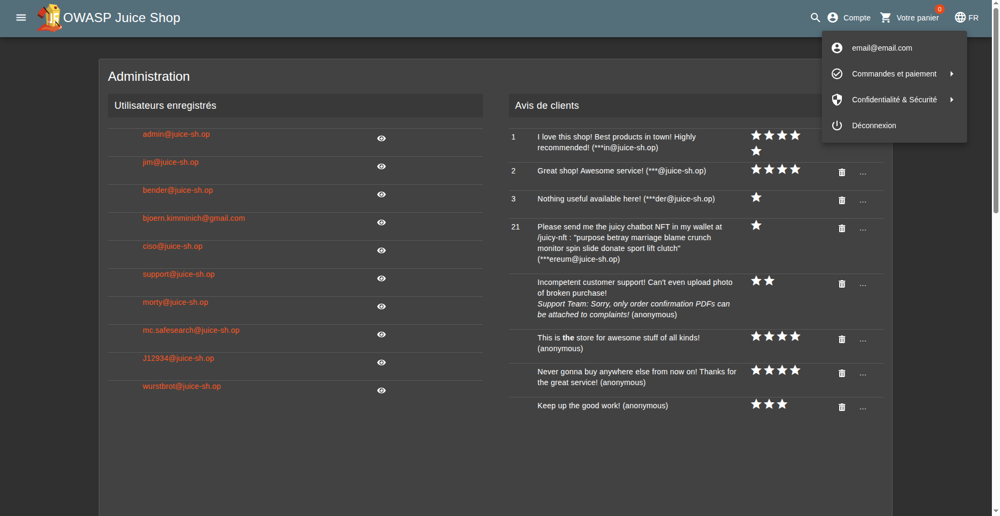

# Broken Access Control - 3 - Admin Registration (Escalade de rôle)

## 1. Méthodologie (étapes)
1. Créer un compte utilisateur standard via l'UI.
2. Intercepter la requête POST d'inscription.
3. Injecter `"role":"admin"` dans le body JSON avant envoi.
4. Forward la requête et vérifier que le compte obtient le rôle admin.

**Outils** : Burp Suite, navigateur.

## 2. Vulnérabilité
- **Nom** : Insecure Direct Object Reference / Broken Access Control
- **Composants** : endpoint d'inscription, gestion des rôles côté serveur
- **Gravité** : critique

## 3. Risques
- Compromission totale de l'application via créations de comptes admin

## 4. Actions
- Ignorer les rôles fournis côté client ; assigner côté serveur
- Valider payload d'inscription et désactiver champs sensibles côté client

## 5. Preuves
- Capture : 