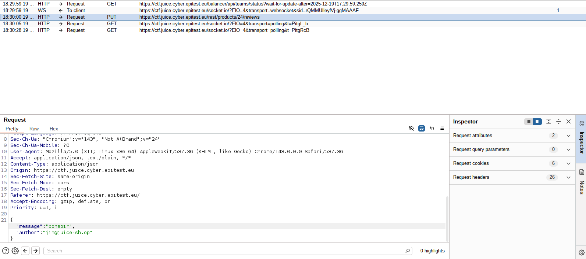

# Broken Access Control - 3 - Forged Feedback

## 1. Méthodologie (étapes)
1. Intercepter la requête d'envoi de feedback.
2. Modifier l'`id` ou payload et forward.
3. Vérifier si le serveur accepte la modification malgré la censure côté client.

**Outils** : Burp Suite.

## 2. Vulnérabilité
- **Nom** : Broken Access Control / Insufficient Filtering
- **Composants** : endpoint feedback, validation côté serveur insuffisante
- **Gravité** : moyenne

## 3. Risques
- Envoi de feedbacks au nom d'autres utilisateurs, spam, fuite d'informations

## 4. Actions
- Authentifier/autoriser actions côté serveur
- Validation stricte des champs

## 5. Preuves
- Capture requête/réponse : 