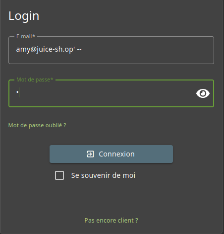
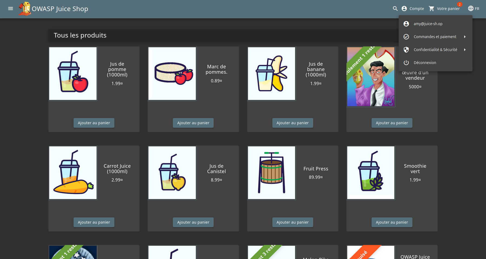

# Broken Authentication - 3 - Login Amy

## 1) Méthodologie (étapes)
1. Ouvrir la page de connexion de Juice Shop.
2. Tenter une injection SQL similaire à celle utilisée pour d'autres comptes :  
   Exemple de payload dans le champ email : `amy@juice-sh.op' --` ou `amy@juice-sh.op' OR TRUE --`
3. Fournir n'importe quel mot de passe et soumettre le formulaire.

Outils : Firefox.

## 2) Vulnérabilité
- Nom : SQL Injection / Authentification contournée.  
- Composants affectés : backend de requêtes SQL.  
- Gravité estimée : élevée.

## 3) Risques 
- Usurpation de compte Amy → actions frauduleuses (commandes, avis), fuite d’informations personnelles.

## 4) Actions 
- Utiliser des requêtes préparées / paramétrées côté serveur.
- Valider et normaliser toutes les entrées côté serveur.
- Mettre en place un WAF et des règles de détection d’injection.
- Journaliser les tentatives d’injection et implémenter des mesures anti‑brute force (blocage temporaire).
- Réduire les informations révélées par les messages d’erreur SQL.

## 5) Preuves / Annexes
- Exemple de payload testé : `amy@juice-sh.op' --`.

