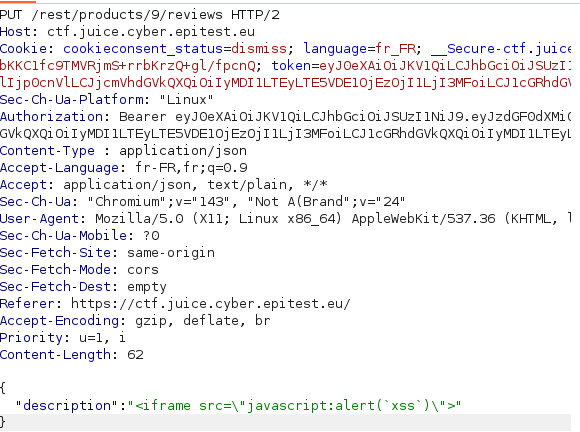

# Cross Site Scripting (XSS) - 3 - API-only XSS

## 1. Méthodologie (étapes)
1. Parcourir la surface API (documentation, endpoints découverts).
2. Récupérer une ressource produit via `GET`.
3. Effectuer un `PUT` sur `/rest/products/<id>` avec un `description` contenant un payload JS (ex : ``).
4. Vérifier si le payload est stocké et rendu dans l'UI consommant l'API.

**Outils** : Burp Suite, DevTools.

## 2. Vulnérabilité
- **Nom** : Stored XSS via API (API-only XSS)
- **Composants** : API produit, rendu client sans échappement
- **Gravité** : élevée

## 3. Risques
- Vol de session, exécution JS, CSRF

## 4. Actions
- Échapper/encoder le contenu rendu
- Valider/nettoyer côté serveur (libs d'assainissement)
- CSP comme défense supplémentaire

## 5. Preuves
- Capture : 