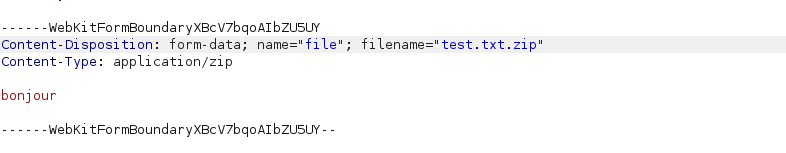
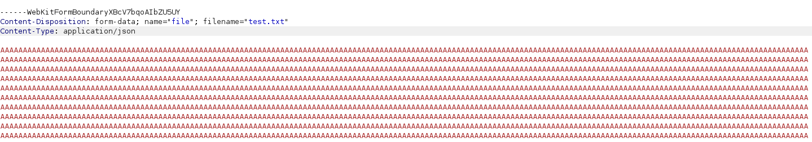

# File Upload - 3 - Upload Size

## 1. Méthodologie (étapes)
1. Identifier l'interface d'upload.
2. Tenter d'uploader un fichier plus grand que la limite client.
3. Intercepter la requête et tester headers (`Content-Length`, `Transfer-Encoding: chunked`) ou fragmentation.
4. Observer la réponse (413, timeout, acceptation).

**Outils** : Burp Suite, curl, scripts Python.

## 2. Vulnérabilité
- **Nom** : Contrôle d'upload insuffisant / validation client only
- **Composants** : endpoint d'upload
- **Gravité** : moyenne à élevée

## 3. Risques
- DoS, upload de fichiers malveillants, consommation ressources

## 4. Actions
- Imposer validation côté serveur, vérifier `Content-Length`, quotas, chunks
- Scanner et stocker hors racine web

## 5. Preuves
- Capture : 

- Capture : 