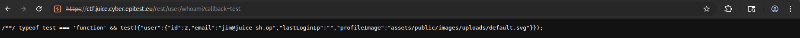

# Information Disclosure - 3 - Email Leak via callback endpoint

## 1. Méthodologie (étapes)
1. Accéder à l'endpoint `/rest/user/whoami?callback=test` sans authentification.
2. Observer la réponse JSONP qui peut contenir emails/informations d'utilisateurs.
3. Documenter les emails récupérés.

**Outils** : navigateur, curl, Burp Suite.

## 2. Vulnérabilité
- **Nom** : Insecure Direct Object Disclosure / Improper Authentication (JSONP)
- **Composants** : endpoint `/rest/user/whoami`, gestion des callbacks
- **Gravité** : moyenne à élevée

## 3. Risques
- Doxxing, facilitation de phishing

## 4. Actions
- Authentifier endpoints retournant données utilisateurs
- Éviter JSONP ou valider strictement le paramètre callback
- Filtrer données sensibles pour utilisateurs non auth

## 5. Preuves
- Capture de la réponse : 