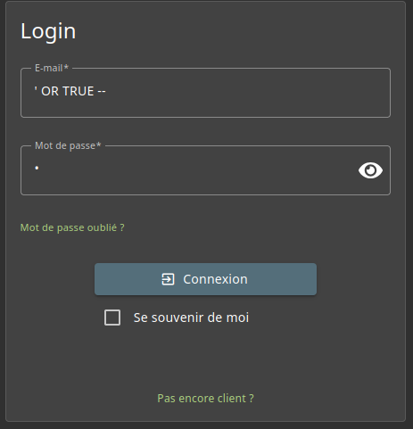
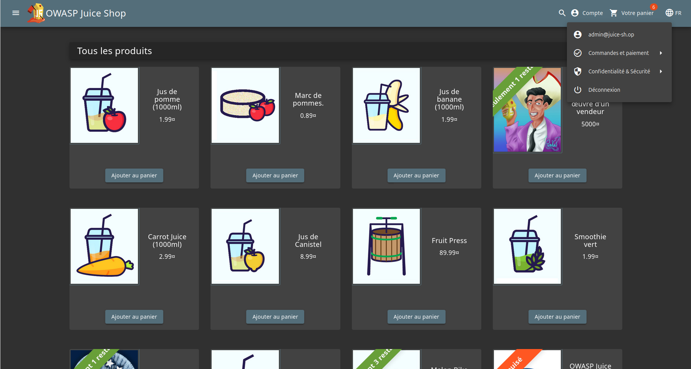

# Injection - 3 - Login Admin

## 1. Méthodologie (étapes)
1. Ouvrir la page de login de Juice Shop.
2. Tester une injection SQL basique dans le champ `email` ou `username` : `' OR "1"="1" --` ou `' OR TRUE --`
3. Soumettre le formulaire. Le payload force l'expression de la condition à vrai et commente le reste de la requête SQL (`--`).
4. Vérifier l'accès au compte administrateur ou récupérer l'email de l'admin dans la réponse.
5. Reporter la preuve (capture d'écran de la session / headers / réponse HTTP).

Outils : Firefox.

## 2. Vulnérabilité
- Nom : SQL Injection (Authentication Bypass).
- Composants affectés : Base de données (requêtes SQL non paramétrées).
- Gravité estimée : critique.

## 3. Risques
- Prise de contrôle d'un compte administrateur, accès à données sensibles, modification de la base (création d'utilisateurs, suppression).

## 4. Actions
- Utiliser des requêtes paramétrées / préparées.
- Valider et normaliser les entrées côté serveur.
- Mettre en place un WAF et détecter tentatives d'injection.
- Journaliser et alerter sur tentatives d'injections répétées.
- Revoir les permissions appliquées aux comptes et limiter les privilèges.

## 5. Reproductibilité / Preuves
- Payload testé : `' OR TRUE --` 

