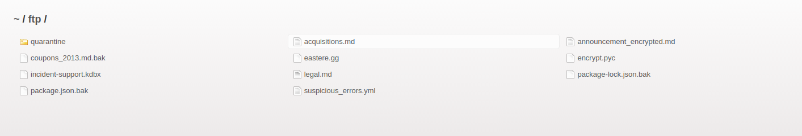

# Security Misconfiguration - 3 - Misplaced Signature File

## 1. Méthodologie (étapes)
1. Parcourir le dossier `ftp`.
2. Trouver le fichier signature.
3. Lire le contenu et documenter sa présence.

Outils : Firefox.

## 2. Vulnérabilité
- Nom : Information Exposure / misplaced sensitive files.
- Composants : infrastructure de stockage, publication web mal configurée.
- Gravité : moyenne.

## 3. Risques
- Révèle informations sensibles.

## 4. Actions
- Nettoyer dépôts publics, restreindre accès fichiers sensibles.

## 5. Reproductibilité / Preuves
- Mettre `ftp` dans l'url à la place du `#`

