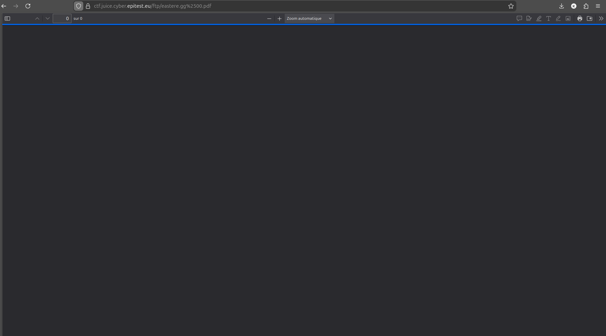

# Security through Obscurity - 3 - Easter Egg (fichier caché)

## 1. Méthodologie (étapes)
1. Accéder à la zone `ftp` (ou tester chemins connus) via l'URL ou via découverte de répertoires.
2. Identifier le fichier Easter Egg (souvent sans extension visible).
3. Forcer l'ouverture en `.pdf` ou `.md` en ajoutant `%2500.pdf` à la ressource (double-encoding pour produire un null-byte après décodage).

**Outils** : navigateur, outils d'URL-encoding.

## 2. Vulnérabilité
- **Nom** : Security through obscurity / Path traversal 
- **Composants** : serveur HTTP, gestion des chemins et décodage
- **Gravité** : faible

## 3. Risques
- Exfiltration de fichiers sensibles, divulgation d'informations internes.

## 4. Actions
- Ne pas dépendre d'obscurité pour protéger ressources.
- Valider/normaliser chemins et décodage URL côté serveur.
- Restreindre accès via auth & ACL.

## 5. Reproductibilité / Preuves
- **Technique** : ajouter `%2500.pdf` ou tester encodages pour forcer le type de lecture.
- **Preuve (image)** : 